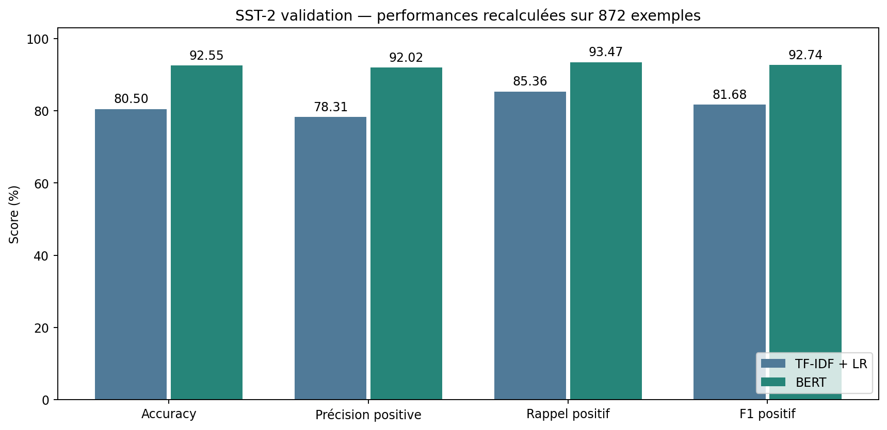
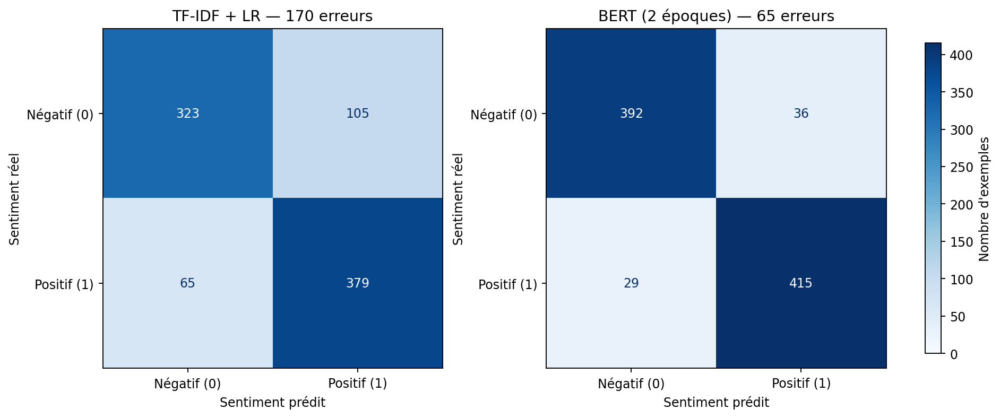
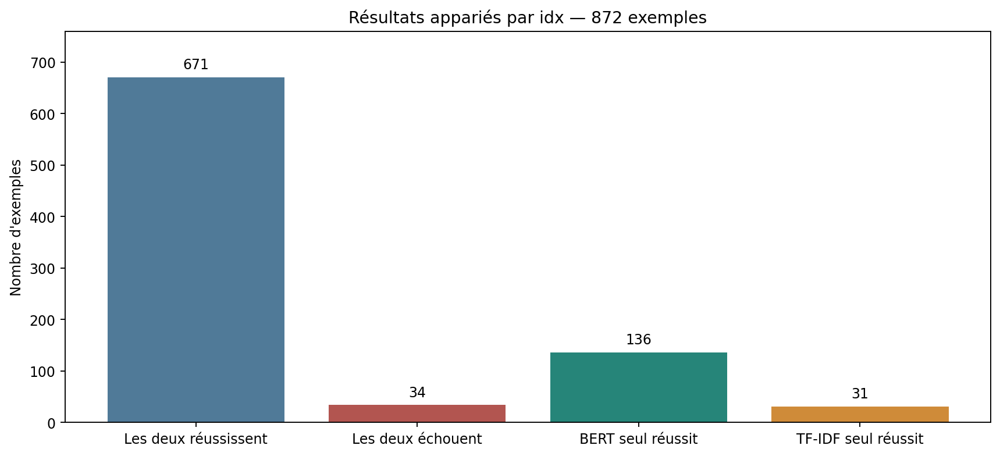
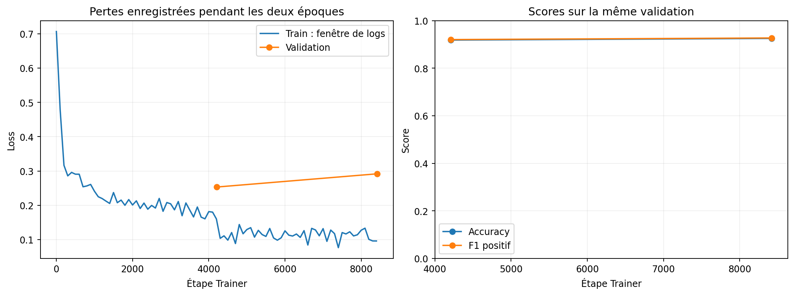
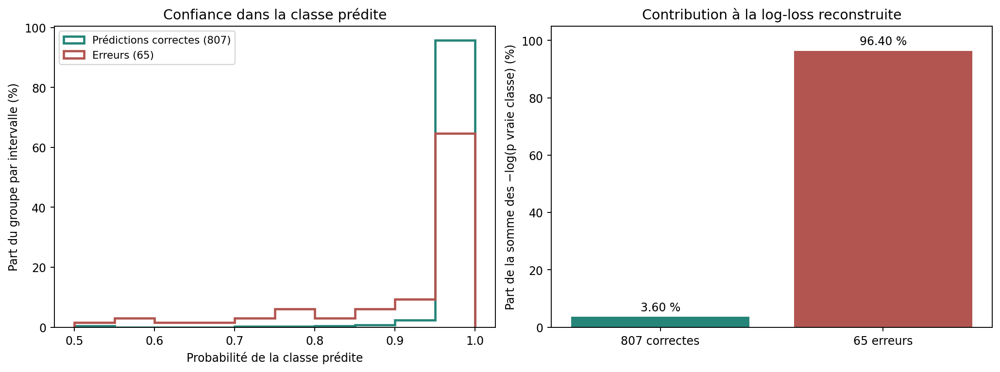

# Comparaison scientifique finale — BERT vs TF-IDF sur SST-2

> Rapport de phase 4 fondé exclusivement sur les prédictions et journaux réels. Aucun modèle n'a été réentraîné pour ce reporting. Les métriques du smoke test sont exclues.

## 1. Objectif scientifique et dataset

Comparer une représentation lexicale TF-IDF suivie d'une régression logistique à un encodeur BERT préentraîné puis adapté à la classification du sentiment. SST-2 (GLUE, configuration nyu-mll/glue/sst2) contient des critiques de films en anglais ; le train comprend aussi des fragments annotés. Le split officiel train comporte **67 349 exemples**, et la validation **872** : **428 négatifs (0)** et **444 positifs (1)**. Aucun label du test officiel n'est exploité.

## 2. Protocole et configuration des modèles

Le vocabulaire, les IDF et le classifieur TF-IDF sont ajustés uniquement sur le train. La référence est celle du commit **ecb4c82e3a36fd1c3d3d05b2efaad01e996feb5a**, conservée dans [tfidf_metrics.json](../results/tfidf_metrics.json) et [tfidf_predictions.csv](../results/tfidf_predictions.csv). Les éventuelles réexécutions de la baseline dans Colab ne remplacent pas cette référence.

**TF-IDF + LR :** unigrammes/bigrammes, min_df=2, max_df=1, max_features=100 000 (74 055 caractéristiques apprises), TF logarithmique, IDF lissée, norme L2, minuscules et aucun stopword. Régression logistique : pénalité L2, C=1, lbfgs, max_iter=1000, tol=1e-4, class_weight=None, seed 42. Aucun réglage sur la validation dans cette baseline.

**BERT :** bert-base-uncased, révision 86b5e0934494bd15c9632b12f734a8a67f723594, tête binaire réinitialisée après seed 42, puis encodeur et tête fine-tunés sur le train. **2 époques**, learning rate **2e-05**, max_length=64, padding dynamique, batch train=16, batch évaluation=32, accumulation=1. AdamW, weight decay nul, scheduler linéaire sans warm-up, clipping à 1. GPU **Tesla T4**, FP16=True. Le modèle de fin d'époque 2 est retenu sans sélection de la meilleure époque selon la validation ; **8 420 étapes** terminées, sans reprise de checkpoint dans cette exécution.

Versions de l'expérience BERT : Python 3.13.16, PyTorch 2.14.1+cu130, Transformers 4.57.6, Accelerate 1.15.0. La durée enregistrée est **789,70 s** (environ 13 min 10 s), validations et sauvegardes comprises. Le temps TF-IDF de 6,43 s est mesuré sur CPU et ne couvre que l'apprentissage : ces durées ne constituent pas un benchmark matériel comparable.

Le MLM préentraîne BERT à reconstruire des tokens masqués ; son encodeur produit des représentations contextuelles. Pour la classification, la représentation de [CLS] passe par le pooler et une tête binaire, entraînée avec l'encodeur. Cette description du modèle fournit un cadre théorique ; notre comparaison ne constitue pas une ablation de ces composants. [Devlin et al., 2019](https://aclanthology.org/N19-1423/).

## 3. Comparaison quantitative recalculée

| Mesure | TF-IDF + LR | BERT | Écart BERT − TF-IDF (pp) |
| --- | --- | --- | --- |
| Accuracy | 80,50 % | 92,55 % | +12,04 |
| Précision positive | 78,31 % | 92,02 % | +13,71 |
| Rappel positif | 85,36 % | 93,47 % | +8,11 |
| F1 positif | 81,68 % | 92,74 % | +11,06 |

TF-IDF : **702 bonnes décisions**, **170 erreurs**. BERT : **807 bonnes décisions**, **65 erreurs**. Gain net : **105 bonnes décisions** ; réduction relative des erreurs : **61,76 %**. Tous les écarts en points sont calculés avant arrondi ; soustraire les pourcentages déjà arrondis peut donner un dernier chiffre différent.

## 4. Matrices de confusion

Lignes = sentiments réels, colonnes = sentiments prédits ; ordre **[négatif (0), positif (1)]**. Même échelle de couleurs et effectifs bruts pour les deux graphiques.

TF-IDF : **[[323, 105], [65, 379]]** ; BERT : **[[392, 36], [29, 415]]**. Les faux positifs diminuent de 105 à 36 et les faux négatifs de 65 à 29. Précision et rappel positifs progressent tous les deux sur ce split.

## 5. Prédictions appariées et McNemar exact

Les fichiers sont fusionnés par **idx**, avec unicité, égalité des ensembles d'identifiants, des textes et des vrais labels. Les quatre groupes couvrent exactement les 872 exemples.

| Situation appariée | Exemples | Part de la validation |
| --- | --- | --- |
| Les deux réussissent | 671 | 76,95 % |
| Les deux échouent | 34 | 3,90 % |
| BERT seul réussit | 136 | 15,60 % |
| TF-IDF seul réussit | 31 | 3,56 % |

BERT réussit 136 des 170 erreurs de la baseline, soit **80 %**, mais échoue sur 31 cas que TF-IDF réussit. Les 136 corrections moins ces 31 régressions donnent le gain net de 105. Les 34 erreurs communes indiquent des difficultés partagées, sans permettre de conclure que leurs causes internes sont identiques. Aucun ensemble combinant les modèles n'a été évalué.

**Test exact bilatéral de McNemar : p = 6.882929e-17.** Sous H0 de symétrie des erreurs, les **167 paires discordantes** ont des directions équiprobables : 136 favorisent BERT et 31 TF-IDF. Le calcul utilise un test binomial exact avec n=167, k=31 et p0=0,5, et a été vérifié par somme des probabilités binomiales. [API SciPy binomtest](https://docs.scipy.org/doc/scipy/reference/generated/scipy.stats.binomtest.html).

Cette asymétrie est statistiquement marquée pour ces modèles fixés et ces exemples appariés. Le test concerne leurs taux d'erreur, pas directement le F1 ; il ne mesure pas la variabilité entre seeds, ne prouve aucun mécanisme causal et suppose l'indépendance entre observations. Des phrases issues d'un même film ou d'une même critique pourraient être dépendantes ; aucun regroupement n'est disponible ici pour le contrôler.

## 6. Dix erreurs réelles de BERT

Les dix identifiants proposés sont tous des erreurs vérifiées dans le CSV final. Cinq sont réussis par TF-IDF et cinq sont des erreurs communes. Leur sélection est illustrative, non aléatoire : aucune fréquence générale de catégories ne doit en être déduite. **0 = négatif ; 1 = positif.** La confiance est la probabilité de la classe prédite, pas une probabilité que la décision soit correcte.

| idx | Phrase originale | Réel | BERT | TF-IDF | Confiance BERT | Hypothèse linguistique |
| --- | --- | --- | --- | --- | --- | --- |
| 205 | falls neatly into the category of good stupid fun .  | 1 | 0 | 1 | 85,23 % | Éloge familier / opinion mixte — « good stupid fun » peut exprimer un plaisir assumé malgré l'adjectif péjoratif « stupid ». Une difficulté de composition du jugement est plausible, sans indice sur le mécanisme interne. |
| 411 | i do n't mind having my heartstrings pulled , but do n't treat me like a fool .  | 0 | 1 | 0 | 98,07 % | Négations et opposition — La concession initiale (« I don't mind ») est suivie d'un reproche introduit par « but ». La portée respective de la concession et du reproche est une difficulté possible. |
| 580 | it takes a certain kind of horror movie to qualify as \` worse than expected , ' but ghost ship somehow manages to do exactly that .  | 0 | 1 | 0 | 98,39 % | Comparaison défavorable / sarcasme possible — « worse than expected » reste négatif malgré la tournure « manages to do exactly that ». Cette réussite formulée comme un échec peut se lire comme sarcastique ; cette lecture n'est pas démontrée. |
| 724 | it 's everything you do n't go to the movies for .  | 0 | 1 | 0 | 99,96 % | Négation idiomatique — La négation renverse une formule qui pourrait sinon être élogieuse : le film représente ce que l'on ne recherche pas au cinéma. L'interprétation globale de l'idiome est une piste. |
| 770 | i do n't think i laughed out loud once .  | 0 | 1 | 0 | 70,74 % | Absence d'une réaction positive — Le locuteur ne rapporte aucun éclat de rire. La négation et « once » orientent ici vers une appréciation négative, sans prouver quel indice BERT a manqué. |
| 93 | if steven soderbergh 's \` solaris ' is a failure it is a glorious failure .  | 1 | 0 | 0 | 85,33 % | Valorisation concessive — « glorious failure » associe un échec à une valorisation paradoxale. Le label positif retient cette valorisation ; l'extrait peut conserver une ambivalence sans contexte supplémentaire. |
| 112 | hilariously inept and ridiculous .  | 1 | 0 | 0 | 99,73 % | Ambiguïté lexicale / humour — « hilariously » peut valoriser le plaisir comique, tandis que « inept and ridiculous » peut aussi être une critique. Le label positif est celui du corpus ; ni l'ironie ni une annotation erronée ne sont établies. |
| 172 | it seems like i have been waiting my whole life for this movie and now i ca n't wait for the sequel .  | 1 | 0 | 0 | 58,36 % | Idiome enthousiaste sous négation — « can't wait for the sequel » exprime une impatience positive malgré sa forme négative. Une lecture trop littérale serait une hypothèse, pas une observation du calcul de BERT. |
| 183 | the lower your expectations , the more you 'll enjoy it .  | 0 | 1 | 1 | 99,95 % | Éloge conditionnel / ironie possible — Le plaisir est conditionné à de faibles attentes, ce qui peut constituer un jugement défavorable. Une lecture ironique est possible, mais la phrase seule ne la démontre pas. |
| 728 | but taken as a stylish and energetic one-shot , the queen of the damned can not be said to suck .  | 1 | 0 | 0 | 78,21 % | Négation d'un jugement négatif / litote — « cannot be said to suck » atténue ou inverse la critique, avec « stylish and energetic » comme appréciation positive. La négation indirecte est une difficulté plausible, sans causalité démontrée. |

Ces hypothèses décrivent des négations, concessions, idiomes, opinions mixtes ou ambiguïtés visibles. Elles ne sont pas des explications causales démontrées et ne reposent sur aucune inspection d'attention ou ablation. L'ironie reste une lecture possible dans les formulations concernées. Les labels surprenants, notamment pour « hilariously inept and ridiculous », sont conservés tels qu'annotés ; nous ne démontrons pas une erreur d'annotation.

## 7. Analyse du risque de surapprentissage et de la confiance prédictive

| Époque | Étape validation | Dernière loss train (fenêtre) | Étape de cette fenêtre | Validation loss | Accuracy | F1 positif |
| --- | --- | --- | --- | --- | --- | --- |
| 1 | 4210 | 0,160300 | 4200 | 0,253271 | 91,8578 % | 92,0670 % |
| 2 | 8420 | 0,096000 | 8400 | 0,291790 | 92,5459 % | 92,7374 % |

**Attention :** 0,160300 et 0,096000 sont les dernières fenêtres de loss train journalisées avant les validations, aux étapes 4 200 et 8 400. Les validations ont lieu à 4 210 et 8 420. Ces valeurs ne sont pas les moyennes d'apprentissage des époques. Le résumé final de Trainer donne une train_loss agrégée de 0,167511 ; elle décrit encore une autre mesure. La loss train avec dropout et fenêtres de lots ne se compare pas directement à une loss de validation évaluée sur tout le split.

**Faits mesurés :** les dernières fenêtres de training loss diminuent de 0,160300 à 0,096000, tandis que la validation loss augmente de 0,253271 à 0,291790. Simultanément, l'accuracy progresse de 91,8578 % à 92,5459 % (six bonnes décisions supplémentaires) et le F1 positif de 92,0670 % à 92,7374 %. Cette divergence constitue un signal à surveiller pour le risque de surapprentissage et l'évolution de la confiance ; deux époques ne suffisent pas à démontrer un surapprentissage.

**Explication possible :** l'accuracy ne change qu'avec la classe argmax ; la log-loss utilise −log(probabilité de la vraie classe). Une mauvaise décision très confiante coûte davantage qu'une erreur hésitante. Une évolution des probabilités peut donc augmenter la loss tout en améliorant le nombre de décisions correctes. C'est une propriété de la mesure, pas une preuve de ce qui a changé entre ces deux époques. [Définition de la log-loss](https://scikit-learn.org/stable/modules/generated/sklearn.metrics.log_loss.html).

**État final vérifié :** 48 des 65 erreurs ont une confiance au moins égale à 90 %, et 20 une confiance strictement supérieure à 99 %. Ces erreurs portent **96,40 %** de la somme des log-loss reconstruites. Les idx 724 et 183 illustrent des décisions erronées à environ 99,96 % et 99,95 % de confiance. Ce constat ne constitue pas une étude complète de calibration.

| idx | Réel | BERT | Probabilité positive | Confiance classe prédite | −log(p vraie classe) |
| --- | --- | --- | --- | --- | --- |
| 544 | 0 | 1 | 0,999815 | 99,9815 % | 8,5978 |
| 519 | 0 | 1 | 0,999661 | 99,9661 % | 7,9886 |
| 724 | 0 | 1 | 0,999607 | 99,9607 % | 7,8422 |
| 183 | 0 | 1 | 0,999549 | 99,9549 % | 7,7036 |
| 95 | 0 | 1 | 0,999459 | 99,9459 % | 7,5220 |

**Contrôle numérique :** la moyenne de −log(p vraie classe) reconstruite en float64 depuis les logits exportés est **0.291784328**, contre **0.291790426** pour la loss enregistrée par Trainer ; écart absolu **6.10e-06**. Il est compatible avec des différences de précision numérique ou d'agrégation, sans que leur contribution exacte ait été isolée. Les métriques discrètes et matrices correspondent exactement. Aucun résultat validé n'est modifié pour effacer cet écart.

**Limite :** les probabilités individuelles de l'époque 1 ne sont pas exportées. Nous ne pouvons donc pas attribuer empiriquement la hausse de loss à un changement précis de confiance sur les mêmes erreurs entre les époques.

## 8. Limites de l'expérience

- Un seul entraînement par approche et une seule seed : aucune estimation de variabilité entre entraînements.
- Une validation unique de 872 exemples, observée à chaque époque, sans test final indépendant ni évaluation hors domaine.
- Des systèmes différents par leur architecture, taille et données de préentraînement : le gain n'isole pas causalement le MLM, [CLS] ou une tête d'attention.
- La troncature à 64 tokens peut retirer du contexte ; son effet n'a pas fait l'objet d'une ablation.
- Dix erreurs choisies pour illustration, contexte parfois limité et annotations pouvant sembler ambiguës : pas de causalité ni de prévalence de catégories démontrée.
- Probabilités d'époque 1 absentes, calibration non évaluée systématiquement, et indépendance entre phrases non garantie pour McNemar.
- Les durées CPU/GPU et périmètres de chronométrage diffèrent ; aucun ratio de coût équitable n'est établi.

## 9. Conclusion principale — sept lignes

Sur SST-2, TF-IDF + régression logistique constitue une référence lexicale solide, avec 80,50 % d'accuracy.  
BERT atteint 92,55 % d'accuracy et 92,74 % de F1 positif après deux époques de fine-tuning supervisé.  
Le préentraînement MLM fournit un point de départ linguistique dont l'encodeur produit des représentations contextuelles.  
La représentation de [CLS], passée par le pooler et la tête binaire, est adaptée avec l'encodeur aux labels SST-2.  
Le gain net de 105 bonnes décisions combine 136 corrections et 31 nouvelles erreurs par rapport à la baseline.  
Les erreurs ambiguës et confiantes, ainsi que la hausse de validation loss, invitent à distinguer correction et qualité probabiliste.  
Ce seul run sur une validation ne démontre ni l'effet causal d'un mécanisme interne ni une généralisation à d'autres domaines.

## 10. Sources et vérifications de reporting

Sources primaires : [métriques TF-IDF](../results/tfidf_metrics.json), [prédictions TF-IDF](../results/tfidf_predictions.csv), [métriques BERT](../results/phase3/bert_metrics.json), [prédictions BERT](../results/phase3/bert_predictions.csv), [historique](../results/phase3/bert_training_history.csv), [erreurs](../results/phase3/bert_errors.csv). L'[audit préalable](audit_phase3_bert_tfidf.md) a guidé la revue, mais les chiffres ont été recalculés à partir des CSV et JSON.

Les six fichiers BERT étaient fournis dans phase3_results.zip ; les copies décompressées sont identiques octet pour octet à cette archive, conservée intacte. Les métriques, matrices, effectifs, probabilités et erreurs sont contrôlés avant génération. La section 4 du notebook a été actualisée pour indiquer l'expérience complète effectuée. Seules les cellules de reporting de section 5 ont été exécutées dans cette phase ; aucune inférence ni aucun entraînement supplémentaire.
